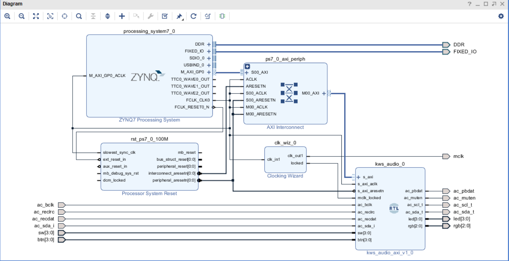

# Real-time Keyword Spotting on a Zynq-7010 FPGA (Digilent Zybo)

Real-time detection of the spoken keywords **"yes" / "no" / unknown** on a Digilent **Zybo**
(Zynq-7010): audio is acquired by custom **VHDL** logic in the programmable logic and classified
by **MFCC features + an MLP neural network** written in bare-metal **C** on the ARM Cortex-A9.



## Architecture

```
 LINE IN / MIC ─► SSM2603 codec ──I²S 48 kHz / 24 bit──►  PL (VHDL)                      PS (ARM Cortex-A9, C)
                    ▲      ▲                              ├ i2s_rx  (oversampled @100 MHz) ├ voice-activity detection
          MCLK 12.288 MHz  │ I²C                          ├ FIFO 8192×32 (BRAM)  ──AXI4-Lite──► ├ 13 MFCC (bit-exact vs librosa)
          (Clocking Wizard)└── ssm2603_ctrl / i2c_master  ├ LEDs, switches, buttons          ├ MLP 13-128-64-32-3 (float)
                                                          └ mic→headphone loopback           └ result on LEDs + UART
```

| Block | Implementation |
|---|---|
| Codec configuration | VHDL I²C master + register sequencer (SSM2603, master mode, 48 kHz, mic or line input selectable at run time) |
| Audio acquisition | VHDL I²S receiver, oversampled in the 100 MHz domain (no clock-domain crossing) |
| Buffering | 8192 × 32-bit BRAM FIFO, ~170 ms of audio |
| PS ↔ PL | Custom AXI4-Lite slave (10 registers) at `0x43C0_0000` |
| Features | MFCC in C: Hann window, radix-2 FFT (512), 26 Slaney mel filters, log-power (top_db 80), DCT-II ortho, time mean → 13 values |
| Classifier | Dense MLP 13→128→64→32→3 (ReLU, softmax), trained in TensorFlow/Keras on Google Speech Commands, weights exported to a C header |

## AI model

Training notebook: [`training/keyword_spotting_training.ipynb`](training/keyword_spotting_training.ipynb) (Kaggle, TensorFlow/Keras, Google Speech Commands v0.02).

| | |
|---|---|
| Features | MFCC, 48 kHz, n_fft 512, hop 512, 26 mel bands, 13 coefficients averaged over 1 s |
| Network | Dense 128 → Dropout 0.3 → 64 → Dropout 0.3 → 32 → softmax 3 (ReLU) |
| Training | Adam 1e-3, class weights, EarlyStopping + ReduceLROnPlateau, 70/15/15 split |
| Data | ~4,000 "yes", ~3,900 "no", "unknown" = 35 other words + 1 s background-noise segments |

The board currently runs the 13-feature model (`model/best_model.keras`, ≈73 % accuracy on its
feature set). The notebook's latest version adds the per-coefficient standard deviation
(26 features) and reaches **81 % test accuracy** (yes 0.90 / no 0.81 / unknown 0.69 F1);
porting it only requires computing the std in `mfcc.c`.

## Verification

| Check | Result |
|---|---|
| GHDL self-checking testbench (`hw/sim`) | I²C sequence (mic and line configurations) acknowledged, I²S samples bit-exact through FIFO/AXI, overflow/clear, LEDs |
| Firmware C compiled on PC vs librosa (`tools/host_test`) | MFCC error ≤ 2·10⁻⁴, probability error ≤ 10⁻⁶ |
| On board | Vivado 2018.2 timing met, codec configured over I²C, I²S frames received at 48 kHz without FIFO overflow |

## Build & run (Vivado / SDK 2018.2, Windows)

1. Install the Digilent board files for **`zybo`** in `<Vivado>/data/boards/board_files/`.
2. Open a serial terminal (115200 8N1) on the board's USB-UART.
3. Run **`clean_rebuild.bat`**: block design → synthesis → bitstream → BSP + application → JTAG programming.

`sw_rebuild.bat` rebuilds only the C code. `open_vivado.bat` / `open_sdk.bat` open the generated projects.

| Control | Function |
|---|---|
| SW0 | input → headphone loopback (hardware) |
| SW1 | automatic detection |
| SW2 | verbose output (MFCC + probabilities) |
| SW3 | raw level (off = gain-independent features) |
| BTN0 / BTN1 / BTN2 / BTN3 | 1 s capture / send audio over UART / status / mic ↔ line input |
| LD0 / LD1 / LD2 | yes / no / unknown |

## Repository layout

```
hw/rtl          VHDL: i2c_master, ssm2603_ctrl, i2s_rx, audio_fifo, kws_audio_axi, top
hw/constraints  zybo.xdc
hw/scripts      build_hw.tcl, bd_system.tcl (scripted block design)
hw/sim          GHDL testbench
sw/src          main.c, mfcc.c, mlp.c, resample.c, model_weights.h
sw/scripts      XSCT scripts: SDK project, JTAG run, boot debugging
tools           Keras → C weight export, librosa reference, UART capture, PC test harness
model           trained Keras model + normalisation statistics
docs            detailed French guide, block design
```

## Debugging notes

* **Board preset matters on Zynq.** The first build used the Zybo Z7-10 preset on a first-generation
  Zybo: the bitstream loaded and the codec answered on I²C, but the PS DDR was misconfigured
  (`0xDEADBEEF` read back as `0x4400BEEF`), so the program crashed before `main()`. Found with XSCT:
  breakpoints, instruction stepping and a DDR write/read test.
* **Features must match training exactly.** The MFCC parameters (48 kHz, n_fft 512, 26 mels) are
  shared between the firmware and the Python tools through a single header, `sw/src/kws_config.h`.

## Author

Rami Dridi, Electrical Engineering, ENIT (Tunis)
