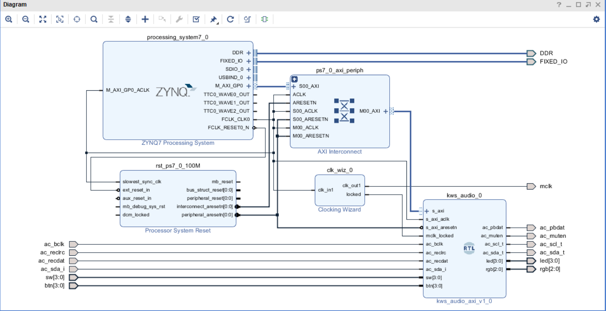

# Keyword Spotting temps réel sur Zynq — Edge AI sur carte Zybo

**Auteur :** Rami Dridi, 3e année Génie Électrique, ENIT
**Carte :** Digilent Zybo (Zynq-7010 : FPGA + double cœur ARM Cortex-A9)
**Outils :** Vivado / SDK 2018.2, VHDL, C bare-metal, Python (TensorFlow / Keras, librosa)
**Code source :** https://github.com/ramidr45/key-word-spotting-zybo-fpga

---

## 1. Objectif

Reconnaître en temps réel les mots **« yes »**, **« no »** et les autres mots (**« unknown »**)
directement sur la carte, sans PC ni cloud : c'est de l'**Edge AI**. Le son est acquis par une
logique matérielle écrite en VHDL, puis un **réseau de neurones** exécuté sur le processeur ARM
du Zynq prend la décision. Le résultat s'affiche sur les LEDs et sur le terminal série.

## 2. Architecture



```
Entrée audio ─► Codec SSM2603 ──I²S 48 kHz / 24 bits──► PARTIE FPGA (VHDL)        PARTIE ARM (C bare-metal)
                   ▲        ▲                          ├ récepteur I²S           ├ détection d'activité vocale
       MCLK 12,288 MHz      │ I²C                      ├ FIFO 8192 × 32 (BRAM)   ├ 13 coefficients MFCC
       (Clocking Wizard)    └ maître I²C + séquenceur  └ périphérique AXI4-Lite ─┤ réseau de neurones MLP
                                                                                 └ LEDs + UART
```

### Partie FPGA (programmable logic), en VHDL

| Module | Rôle |
|---|---|
| `i2c_master.vhd` + `ssm2603_ctrl.vhd` | configuration du codec audio par I²C (mode maître, 48 kHz, entrée micro ou ligne) |
| `i2s_rx.vhd` | réception des échantillons audio 24 bits (bus I²S suréchantillonné à 100 MHz) |
| `audio_fifo.vhd` | tampon de 8192 échantillons en BRAM (~170 ms) |
| `kws_audio_axi.vhd` | périphérique **AXI4-Lite** personnalisé (10 registres, adresse `0x43C0_0000`) entre le FPGA et l'ARM |
| Clocking Wizard | horloge maître du codec à 12,288 MHz |

### Partie processeur (ARM Cortex-A9), en C bare-metal

| Étape | Détail |
|---|---|
| Détection d'activité | énergie par blocs de 20 ms comparée au bruit de fond, fenêtre d'1 s autour du mot |
| Extraction des features | 13 **MFCC** : fenêtre de Hann, FFT 512 points, 26 filtres mel, log, DCT, moyenne sur 1 s |
| Classification | **MLP** 13 → 128 → 64 → 32 → 3 (ReLU, softmax) |
| Sortie | LD0 = yes, LD1 = no, LD2 = unknown, et une ligne sur l'UART à 115 200 bauds |

## 3. Le réseau de neurones

- **Entraînement :** sur Kaggle (GPU), avec TensorFlow / Keras.
- **Données :** dataset Google Speech Commands v0.02. Environ 4 000 « yes », 3 900 « no », et une
  classe « unknown » composée de 35 autres mots et de segments de bruit de fond.
- **Réseau :** Dense 128 → Dropout 0,3 → 64 → Dropout 0,3 → 32 → softmax 3, environ 14 000 paramètres.
- **Déploiement :** les poids et la normalisation sont exportés automatiquement du fichier `.keras` vers
  un header C (`model_weights.h`), puis l'inférence est exécutée en C sur l'ARM.
- **Précision :** la version qui utilise la moyenne et l'écart-type des MFCC (26 features) atteint
  **81 %** sur le jeu de test (F1 : yes 0,90, no 0,81, unknown 0,69). La version embarquée
  actuellement utilise 13 features (moyenne seule).

## 4. Résultats et vérifications

| Vérification | Résultat |
|---|---|
| Simulation VHDL (GHDL), banc de test auto-vérifiant | configuration I²C correcte et acquittée, échantillons I²S retrouvés à l'identique en sortie de FIFO/AXI, gestion du débordement |
| Synthèse et implémentation Vivado | 0 erreur, timing respecté |
| Codec sur la carte | configuré par I²C, trames I²S reçues à 48 kHz sans perte |
| Chaîne audio sur la carte | signal reçu correctement par l'entrée ligne (niveau mesuré jusqu'à -2 dBFS) |
| MFCC en C comparés à la référence Python (librosa) | écart maximal de 2·10⁻⁴, probabilités identiques à 10⁻⁶ près |
| Temps d'inférence du réseau de neurones sur l'ARM | **≈ 0,12 ms** (mesuré sur la carte) |
| Reconnaissance sur la carte | chaîne complète fonctionnelle de l'acquisition à la décision ; précision en conditions réelles : *à compléter* |

## 5. Difficultés rencontrées

1. **Programme bloqué avant `main()`.** Le bitstream se chargeait et le codec répondait, mais rien ne
   s'affichait sur le terminal. Un diagnostic par JTAG avec XSCT (points d'arrêt, exécution pas à pas,
   test d'écriture et de relecture mémoire) a montré que la **mémoire DDR était corrompue**, car le
   projet utilisait le preset de la Zybo Z7 au lieu de celui de la Zybo de première génération.
   Corrigé en changeant de preset et de fichier de contraintes.
2. **Aucun échantillon audio reçu.** Les broches I²S diffèrent entre les deux versions de la carte.
   Corrigé avec le fichier de broches officiel de la Zybo.
3. **Micro de téléphone non reconnu.** Une fiche à 4 contacts n'est pas compatible avec l'entrée micro.
   J'ai donc ajouté une **entrée ligne** sélectionnable par bouton, pour tester avec des enregistrements.
4. **Reconnaissance faible au départ.** Les paramètres MFCC de la carte ne correspondaient pas à ceux de
   l'entraînement. Je les ai alignés sur le notebook (48 kHz, FFT 512, 26 bandes mel) et le volume est
   maintenant compensé automatiquement.

## 6. Utilisation

1. `clean_rebuild.bat` : construit tout le projet (block design, bitstream, application) et programme la carte.
2. Terminal série à 115 200 bauds. **SW1** active la détection automatique, **BTN0** lance une capture d'1 s,
   **BTN2** affiche l'état et **BTN3** bascule entre micro et entrée ligne.
3. `run_board.bat` reprogramme la carte après une mise sous tension, et `sw_rebuild.bat` recompile seulement le C.

## 7. Perspectives

- Embarquer le modèle à 26 features (moyenne + écart-type), qui atteint 81 % en test.
- Mesurer la précision sur la carte avec le jeu de test officiel joué sur l'entrée ligne.
- **Accélérer une partie du calcul dans le FPGA** (FFT ou multiplications du MLP en virgule fixe Q8.8)
  pour aller vers une IA accélérée matériellement.
- Démarrage autonome depuis la carte SD (`BOOT.BIN`).
